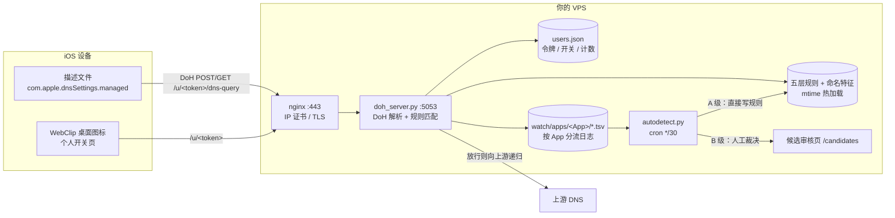

# hongguo-doh

> 自建 DoH（DNS-over-HTTPS）节点 + 精细化广告域名过滤 + **广告域名自动发现引擎**，
> 面向 iOS 全局加密 DNS 描述文件。零客户端 App、零根证书、零 MITM。


## 这是什么

一个可以直接跑在任意一台 VPS 上的小型 Python DoH 服务。iOS 安装一份 `com.apple.dnsSettings.managed`
描述文件后，整机 DNS 走这个节点，服务端按域名规则返回 `0.0.0.0` 实现广告拦截。

它不是另一个 AdGuard Home，差别在三点：

1. **规则极窄**。不订阅整份百万级名单，只拦"你的设备真的查询过、且能确认是广告"的域名。
   项目自带的规则文件总共不到 10 KB，避免整域误杀（实测过的坑：`isnssdk.com`、`p3-novel.byteimg.com`
   这类通用名单里的整域规则会直接让 App 白屏）。
2. **能自己发现新广告域**。内置的 `autodetect.py` 每 30 分钟跑一次，从真实查询日志 +
   公开名单 + 字节系广告指纹 + 启动期突发行为里找出新广告域，自动拦截或推到审核页。
   包括会**随机换子域**的广告 DGA 域（例如 `*.jspcdn.cn` 这种客户端每次生成新串的父域），
   引擎会自动把它收敛成整域规则。
   另外 `ad_feedback.py --auto` 每 5 分钟扫一次最近放行的陌生广告域，
   专抓「历史只出现过几次、当天又预取」的低频漏网域，无需任何人报时刻。
   它同时反向读拦截日志识别「广告触发」：命中广告规则的被拦请求会记成触发，
   触发前后 5 秒放行的域列成伴随的容器/素材通道；`/feedback` 页面能看到
   「这一刻广告请求确实被拦了，但素材走的是与正片共用的 CDN」。这些伴随域
   **只报告、不自动拦**，避免误伤共用 CDN 导致白屏。
3. **多人共用、互不干扰**。每人领一个专属令牌，各自有独立开关页和桌面图标，
   关掉自己的开关不影响别人，且不用重装描述文件。**规则文件是全局一份**
   （`blacklist-shared.txt` 按 mtime 热加载），补一条规则所有用户立即生效；
   按令牌独立的只有开关状态和查询计数，更新规则不需要给任何人重装描述文件。
   桌面图标点开的开关页里有「分享给朋友」按钮，发出去的 `/invite` 链接不含你的令牌，
   对方领到的是自己那份独立的描述文件与开关。

## 架构



## 功能一览

| 功能 | 说明 |
|---|---|
| DoH 服务 | 纯标准库实现，支持 GET（`?dns=` base64url）与 POST，A / AAAA / CNAME 等常见类型 |
| 五层规则 | `force-block.txt` > `whitelist.txt` > `ad-signatures.txt` > `blacklist.txt` + `blacklist-shared.txt` |
| 命名特征层 | 不枚举具体域名，按广告命名结构判定；换编号 / 换 CDN 别名的**新域名第一次出现就拦**，不必等名单更新 |
| 热加载 | 改规则文件立即生效，不重启服务、不重装描述文件 |
| 多用户 | `/issue` 签发令牌；`/u/<token>/dns-query` 按开关门控；`/u/<token>` 开关 / 清除 / 刷新 |
| 后台 | `/users` 用户列表、`/stats` 全局状态、`/candidates` 候选广告审核 |
| 桌面图标 | Web Clip 与 DNS 设置合并进同一份描述文件，点开就是自己的开关页 |
| 分享安装 | 开关页「分享给朋友」→ `/invite` 邀请页：复制链接 / 系统分享 / 二维码，链接不含令牌 |
| 日志分流 | 按 App（红果 / 抖音 / 微信 / 京东 / 网易云 / …）、按天、按成功/拦截分开，默认留 30 天 |
| 自动发现 | 公开名单交集、字节系广告指纹、电商广告指纹、广告线索组件、启动期突发、DGA 随机子域收敛、陌生随机父域收敛 |
| 反馈归因 | `/feedback` 一键回溯前 6 分钟放行日志，自动找漏拦陌生域写规则，报告可审计、可回滚 |
| 误伤护栏 | 白名单父域保护、大厂保护父域降级人工、所有子域标签须带广告特征、`#auto:` / `# feedback:` 标签可整批回滚、dry-run 工具 |

## 目录

```
hongguo-doh/
├── LICENSE                  MIT
├── README.md                本文件
├── .gitignore               运行期数据 / 凭据 / 用户日志一律排除
├── .env.example             所有可配置项（含示例值）
├── src/
│   ├── doh_server.py        DoH 服务 + 多用户 + 描述文件生成 + 页面
│   ├── autodetect.py        广告域名自动发现引擎
│   ├── ad_feedback.py       反馈归因 / 无人值守补漏
│   ├── signature_report.py  命名特征体检 + 自动归纳（业务域误伤回放）
│   ├── watch.py             日志分流 / App 会话识别
│   └── gen_profile.py       离线生成描述文件
├── rules/
│   ├── ad-signatures.txt    广告命名特征（覆盖未见过的新域名，0 误伤回放）
│   ├── blacklist.txt        基础广告规则
│   ├── blacklist-shared.txt 共享广告规则（常开，#auto: 为引擎写入）
│   ├── whitelist.txt        业务域白名单
│   └── force-block.txt      强制拦截例外（优先级高于白名单）
├── config/
│   ├── nginx-hongguo-doh.conf.example
│   ├── nginx-locations.conf.example
│   ├── hongguo-doh.service
│   ├── hongguo-autodetect.timer / .service（可选）
│   ├── crontab.example
│   └── logrotate.example
├── tools/
│   ├── ecs_run.py           阿里云 ECS 云助手远程执行（凭据走环境变量）
│   ├── push_file.py         分片推送文件到服务器
│   ├── fetch_file.py        分片拉取服务器文件
│   ├── verify_rules.py      真发 DoH 查询验证拦截 / 误伤
│   ├── check_rules.py       规则文件静态检查
│   ├── dga_dryrun.py        DGA 自动收敛 dry-run
│   └── check_before_push.py 发布前敏感信息自检
├── docs/
│   ├── DEPLOY.md            从零部署（证书 / nginx / systemd / cron）
│   ├── IOS_PROFILE.md       iOS 描述文件与实测踩坑
│   ├── ARCHITECTURE.md      协议、匹配优先级、日志格式
│   ├── RULES.md             规则语法、自动发现分级、误伤回滚
│   ├── PUBLISH.md           GitHub 上架清单
│   └── FAQ.md
├── examples/
│   └── profile.template.mobileconfig
└── .github/                 CI / Issue 模板 / PR 模板
```

## 快速开始

```bash
# 1. 准备一台有公网 IP 的 Linux（Ubuntu 22.04 实测），放行 80 / 443
git clone https://github.com/wangdanian/hongguo-doh.git
cd hongguo-doh
cp .env.example .env            # 填入你的服务器 IP / 域名
# 按 docs/DEPLOY.md 的分步命令部署（证书、nginx、systemd、cron）

# 2. 装依赖（服务本体只需 Python 标准库）
sudo apt install -y nginx python3
sudo cp src/*.py /opt/hongguo-doh/
sudo cp rules/*.txt /opt/hongguo-doh/
sudo cp config/hongguo-doh.service /etc/systemd/system/
sudo systemctl daemon-reload && sudo systemctl enable --now hongguo-doh

# 3. 配 nginx + 证书 + cron，然后手机访问 https://<你的地址>/ 领专属描述文件
```

完整命令（含 Let's Encrypt **IP 证书**的申请方式、nginx 三个 server 块、logrotate、
自动发现 cron）见 **[docs/DEPLOY.md](docs/DEPLOY.md)**。

## 三个必须知道的实测结论

1. **iOS 会忽略 `ServerURL` 里的非标端口**。写 `https://203.0.113.10:8443/dns-query` 时，
   实测手机实际连的是 **443**。所以服务端必须在 443 上监听，别只开 8443。
   见 [docs/IOS_PROFILE.md](docs/IOS_PROFILE.md)。
2. **规则里不要写行内注释**。`load_shared()` 不解析行内注释，
   `example.com**  # 广告` 会被当成整条规则串，永远不匹配。注释必须独立成行。
3. **整域收敛要写两条规则**。`父域**` 只匹配以父域开头的串（覆盖 CNAME 后缀域），
   随机子域是 `xxx.父域`，还需要 `**.父域**`。只写一条会漏。见 [docs/RULES.md](docs/RULES.md)。

## 能力边界（DNS 层物理上做不到的）

- **信息流里的原生广告卡片**：由 feed API 在响应内容里下发，广告视频与正常视频共用 CDN。
  服务端只看得到域名，看不到"这一条 feed 是广告"。拦掉独立广告域能断掉追踪、
  留资线索、落地页和素材预载，但抹不掉容器本身。
- **后台预缓存的素材**：冷启动时零 DNS 请求，DNS 层看不见。
- **"跳过"倒计时 / 开屏 UI**：App 内部逻辑，DNS 碰不到。素材拉不到时多数 App 直接跳首页，
  少数会留几秒空白。
- 想按 URL 路径 / 响应体过滤，需要 iOS 全局代理 + MITM + 根证书。本项目**不做** MITM，
  不装根证书，描述文件里只有 DNS 设置和 Web Clip 两个 payload。

## 隐私

所有日志、令牌、客户端 IP 都只存在你自己的服务器上，不上传、不回传、无遥测。
`watch/` 默认保留 30 天，`doh_log.txt` 由 logrotate 管 14 天。
发布前请务必运行 `python3 tools/check_before_push.py` —— 它会扫描 AK/SK、私钥、
`users.json`、真实公网 IP、日志和备份文件，确认干净才允许提交。

## 上游名单与许可

`autodetect.py` 在**运行时按需下载**三份公开名单（默认 24 小时缓存），
本仓库**不分发任何上游名单文件或合并快照**：

| 来源 | 地址 | 许可 |
|---|---|---|
| anti-AD | `https://anti-ad.net/domains.txt` | MIT |
| oisd (small) | `https://small.oisd.nl/domainswild` | 见其项目页面 |
| AdGuard DNS Filter | `https://adguardteam.github.io/AdGuardSDNSFilter/Filters/filter.txt` | GPL-3.0 |

下载的数据只在本机内存/缓存里参与比对，不随本仓库再分发；使用者若打算
**再分发合并后的名单**，需自行遵守各上游项目的许可与署名要求。
`rules/` 下随仓库提供的是本项目自行整理、针对具体 App 验证过的少量规则。

## 参与贡献

最欢迎三种贡献：**漏拦的域名**（附日志证据）、**误伤报告**（哪个功能坏了）、
**规则 / 引擎改进**。提 PR 前请跑：

```bash
python3 -m py_compile src/*.py tools/*.py
python3 tools/verify_rules.py           # 需要一个已启动的服务
python3 tools/dga_dryrun.py             # 检查自动收敛会不会误伤
python3 tools/check_before_push.py      # 敏感信息自检
```

详见 [CONTRIBUTING.md](CONTRIBUTING.md) 与 [docs/RULES.md](docs/RULES.md)。

## 发布到 GitHub

仓库已经是从干净副本初始化的（不含凭据、用户数据、日志、名单快照），
`publish.sh` 会跑完自检后 push。**别从私有工作区直接 push 再删文件——
公开仓库的全部历史都可被克隆**。账号权限、仓库设置、Topics、分支保护、
必须替换的默认值，见 [docs/PUBLISH.md](docs/PUBLISH.md)。

## 许可

[MIT](LICENSE) — 可自由使用、修改、商用，保留版权与许可声明即可。
